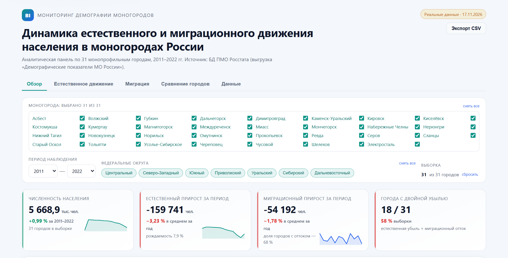
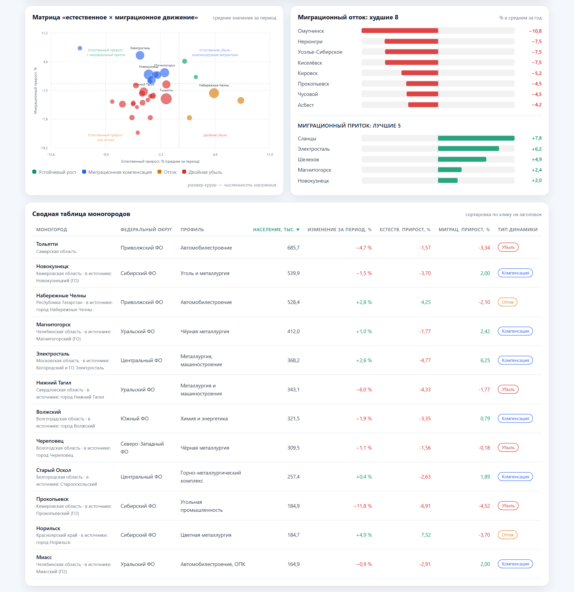
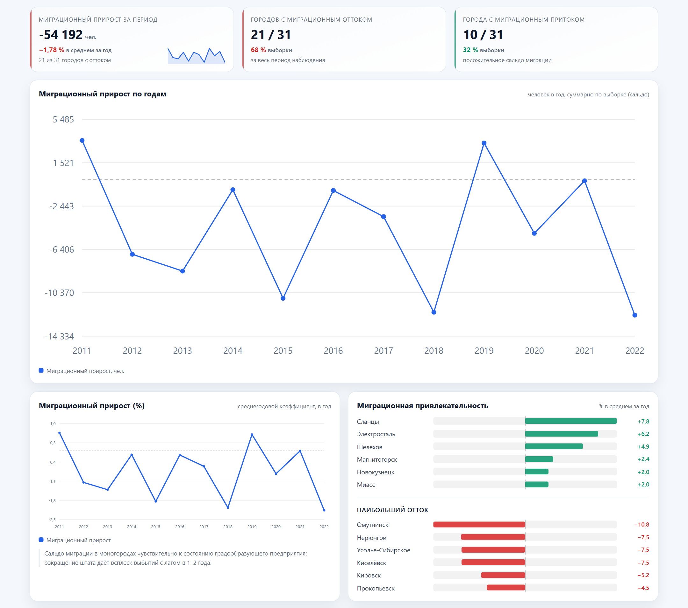
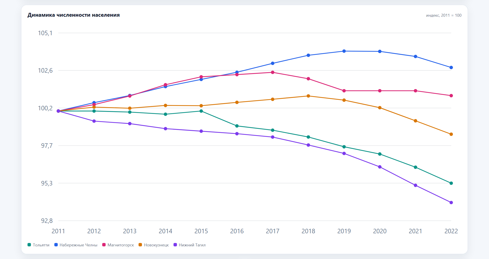
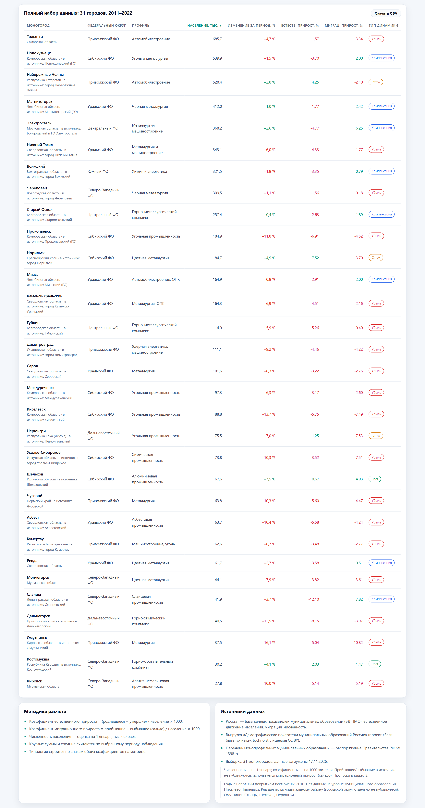

# Моногорода России — BI-панель демографической динамики


Одностраничное приложение для анализа демографических процессов в монопрофильных
муниципальных образованиях РФ (перечень — распоряжение Правительства РФ № 1398-р).
Считает естественное и миграционное движение населения, строит типологию городов
и рейтинги, сравнивает города по индексу численности и выгружает результат в CSV.

Работает на **реальных данных Росстата**: панель собирается из выгрузки Базы данных
показателей муниципальных образований (БД ПМО), генерации и заглушек в цифрах нет —
без подготовленного набора данных приложение показывает экран с инструкцией по сборке.

## Скриншоты

| Обзор: фильтры и ключевые показатели | Диаграммы и матрица типологии |
| --- | --- |
|  |  |

| Раздел «Миграция» | Сравнение городов |
| --- | --- |
|  |  |



## Возможности

- **Фильтры** — федеральные округа (чекбоксы), города выбранных округов, период (два списка
  лет); кнопки «выбрать все / снять все», счётчик выбранных городов.
- **Обзор** — KPI карточки (численность, естественный и миграционный прирост, доля городов
  с двойной убылью), графики по годам, матрица типологии, двусторонние рейтинги по округам,
  сводная таблица.
- **Естественное движение** и **Миграция** — разрезы по годам, округам и городам.
- **Сравнение городов** — индекс численности (2010 = 100) для выборки до 8 городов.
- **Данные** — полный набор показателей с сортировкой по клику на заголовок, выгрузка CSV,
  описание методики и источников.
- Адаптивная вёрстка: на узких экранах сетка диаграмм становится одноколоночной.

## Источник данных

| Что | Где |
| --- | --- |
| Первичный источник | Росстат, БД ПМО — <https://rosstat.gov.ru/dbscripts/munst/> |
| Готовая плоская выгрузка (CSV) | «Демографические показатели муниципальных образований России», проект «Если быть точным» — <https://tochno.st/datasets/mun_demography> (DOI: 10.48612/tochno/mun_demography) |
| Охват выгрузки | 2284 муниципалитета из 78 регионов, 2010–2023, 31 947 наблюдений |
| Показатели | численность населения на 1 января, среднегодовая численность, родившиеся, умершие, миграционный прирост, общие коэффициенты рождаемости / смертности / миграционного прироста |
| Перечень моногородов | распоряжение Правительства РФ № 1398-р (список — `src/data/monogorods.js`) |

Текущий результат сборки: сопоставлено **31 город из 33** за **2011–2022**.
Не сопоставлены «Пикалёво» и «Тырныауз» — в источнике нет муниципального образования
верхнего уровня с такими названиями (города входят в состав районов).

Ограничение источника: публикуется только сальдо миграции, без разбивки на прибывших
и выбывших. Если в данных появятся отдельные показатели «Число прибывших» / «Число выбывших»,
панель покажет их автоматически (флаг `HAS_FLOWS` в `src/data/towns.js`).

## Быстрый старт

```bash
git clone https://github.com/Your0ff/BI-kyrsa4.git
cd BI-kyrsa4
npm install
npm run dev          # http://localhost:5173
```

Требуется Node.js 18+ (нужен встроенный `fetch` при сборке данных).

В репозитории уже лежит собранный `src/data/monogoroda.json`, так что панель запустится
сразу. Пересобрать данные из свежей выгрузки:

```bash
# из локального файла CSV
npm run data -- --file mun_demography.csv

# или скачать со страницы датасета
npm run data

# или по прямой ссылке
npm run data -- --url "https://..."
```

Скрипт (`scripts/fetch-data.mjs`):

1. читает CSV (или скачивает его), автоопределяет разделитель и названия колонок
   (русские и английские варианты, в т.ч. `migration`, `migration_rate`, `birth_rate`);
2. определяет масштаб величин (человеки/тыс. человек, «на человеко-год»/‰) и сверяет его
   по коэффициентам;
3. сопоставляет моногорода с муниципальными образованиями: сначала совпадение субъекта РФ,
   затем похожесть основы названия («Магнитогорский (ГО)» → Магнитогорск, «Киселёвский» →
   Киселёвск, «город Норильск» → Норильск, «Богородский и ГО Электросталь» → Электросталь);
   при равном счёте побеждает городской округ, а не район; алиасы — в `src/data/monogorods.js`;
4. чистит ряд: убирает строки без численности и годы с покрытием менее 90 % городов
   (так из выгрузки исключён 2010 год — по пяти городам данных нет);
5. пишет `src/data/monogoroda.json` и печатает отчёт: сколько городов сопоставлено, какие нет,
   какие похожие названия МО есть рядом, пример ряда.

Если dev-сервер уже работал, после `npm run data` перезапустите `npm run dev`,
чтобы Vite подхватил новый файл данных.

## Сборка

```bash
npm run build     # production-сборка в dist/
npm run preview   # локальный просмотр сборки
```

`base: './'` в `vite.config.js` — сборку можно открыть с любого пути, в том числе
на GitHub Pages без дополнительных настроек.

## Структура проекта

| Файл | Назначение |
| --- | --- |
| `src/data/monogorods.js` | канонический список моногородов: регион, федеральный округ, отрасль, алиасы названий |
| `src/data/towns.js` | загрузка `monogoroda.json`, список лет, округов, метаданные |
| `src/data/monogoroda.json` | подготовленный набор: значения по городам и годам |
| `src/lib/stats.js` | коэффициенты, агрегация, типология, индекс численности, экспорт CSV |
| `src/App.jsx` | композиция разделов, фильтры, состояние выборки |
| `src/components/LineChart.jsx` | многорядный линейный график с подсказками |
| `src/components/GroupedBars.jsx` | сгруппированные столбцы |
| `src/components/RankBars.jsx` | двусторонний рейтинг (влево/вправо от нуля) |
| `src/components/ScatterQuadrant.jsx` | матрица «естественный прирост × миграционный прирост» |
| `src/components/DataTable.jsx` | таблица с сортировкой по клику на заголовок |
| `src/components/DataSetup.jsx` | экран-инструкция, если данные не загружены |
| `scripts/fetch-data.mjs` | загрузка и сборка данных (`npm run data`) |
| `scripts/lib/demography.mjs` | чистые функции разбора CSV и сопоставления МО |

Разделы панели: **Обзор**, **Естественное движение**, **Миграция**, **Сравнение городов**,
**Данные**.

## Методика

- Естественный прирост — `(родившиеся − умершие) / население × 1000`.
- Миграционный прирост — `(прибывшие − выбывшие) / население × 1000` (сальдо).
- Оба показателя — коэффициенты на 1000 человек населения; в интерфейсе подписаны знаком `%`.
- Типология по знакам обоих коэффициентов: устойчивый рост, миграционная компенсация,
  отток при естественном приросте, двойная убыль.
- Индекс численности — отношение среднегодовой численности к базовому году (2010 = 100).
- Численность показывается в тыс. человек, абсолютные величины — в человеках.
- При агрегации по выборке абсолютные величины суммируются, коэффициенты считаются
  по суммарным числителю и знаменателю, а не как среднее коэффициентов.
- Типология и матрица строятся только по городам, у которых определены оба коэффициента.

## Ограничения

- Миграция — только сальдо, структура потоков (прибывшие / выбывшие) источником не раскрывается.
- Для Омутнинска, Сланцев, Шелехова и Нерюнгри ряд дан по муниципальному району: отдельного
  городского округа источник не публикует (это указано в разделе «Данные»).
- Период 2011–2022: 2010 год исключён из-за неполного покрытия, 2023 год не включён,
  так как по части городов данные ещё не опубликованы в сопоставимом виде.
- Коэффициент за длинный период — это сумма годовых коэффициентов; он показывает накопленный
  масштаб, а не темп роста и не должен читаться как «процент населения в год».

## Публикация на GitHub Pages

```bash
npm run build
npx gh-pages -d dist      # либо вручную загрузить dist/ в ветку gh-pages
```

В настройках репозитория: **Settings → Pages → Source: Deploy from a branch → gh-pages / root**.

## Источники и цитирование

Данные Росстата — открытая информация (Федеральный закон № 8-ФЗ). Выгрузка tochno.st
распространяется по лицензии CC BY: при использовании указывайте источник —
«Если быть точным», набор «Демографические показатели муниципальных образований России».

Курсовая работа: отчёт с описанием концепции, требований и методики — `Ot4et_monogoroda.docx`.
